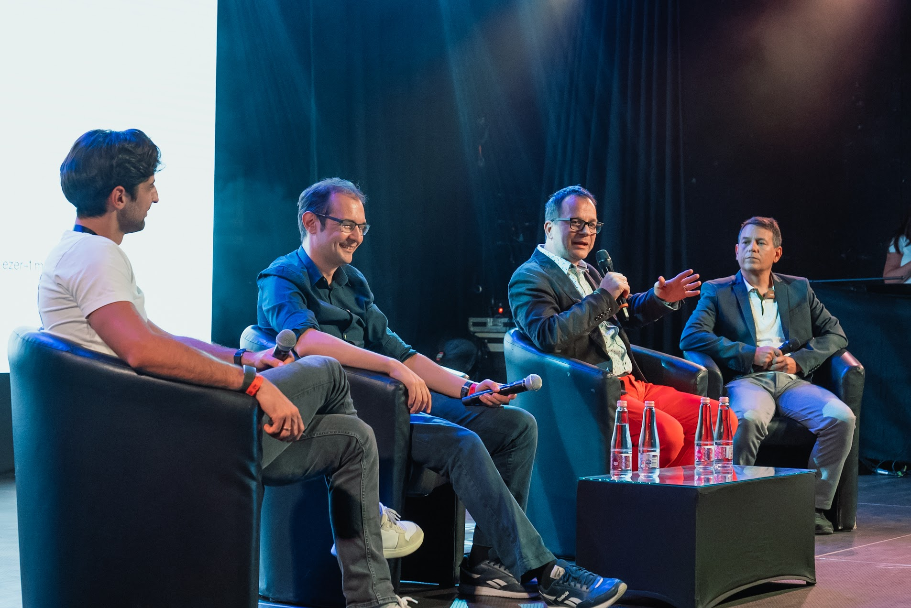
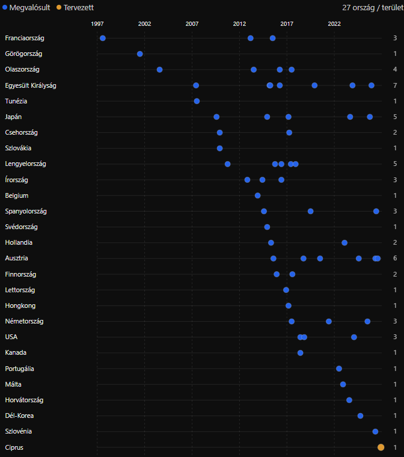

  <header class="post-hero">
    
Adam on FIRE · Blog

    <h1 class="post-title">{{ page.title | escape }}</h1>
    
{{ page.date | date: "%Y. %m. %d." }}

  </header>

  <article class="post-body">

Ez az ősz eddig a visszatekintésről szólt nekem. Miután felléptem a Lightyear Universe '26 rendezvényén Balog Petyával és Bognár Balázzsal, kicsit elfogott a nosztalgia. Ott a színpadon ülve kezdtem el gondolkodni azon, hogy "hogy is kerültem én ide?"

Hiszen ki is vagyok én? Egy srác, aki 16 éve dolgozik, szépen teszi félre a pénzét, közben meetingekre jár, okosakat mond, és ennyi. Aztán kicsit továbbgondoltam a dolgot, hogy "igen, de egyébként a politikával is foglalkozik, meg menedzseli a pénzügyeit, mindenről kimutatást vezet, és mindent rendszerez". Aztán itt a kimutatásoknál kezdtem el azon gondolkodni, hogy mi az, ami igazán érdekelne engem a múltamból.

Először a Garmin órám adatait kezdtem el feldolgozni. Szerencsére minden nagyobb szolgáltatónál van már adatlekérési lehetőség, és néhány nap után egy szép kis csomagot kaptam JSON formátumban. Szerencsére ezt nagyon szereti a ChatGPT, úgyhogy rögtön ki is válogattam neki az adatokat, elmondtam, hogy milyen struktúrában szeretném megkapni, és hasonlók. 20 perc múlva már az elmúlt 1000 nap alvási-, mozgási-, és stresszadataimat olvasgathattam. Elképesztő dolgokra képes az AI az adatelemzés terén, tényleg tizedannyi (vagy még kevesebb) idő alatt képes fogyasztható outputot gyártani. Lényeg, hogy a 3 évnyi adatból kirajzolódott, hogy mostanában kicsit többet sétálok, igaz, még mindig rendszertelenül, kicsit jobban alszom, viszont napközben többet stresszelek. Ez utóbbi kicsit aggaszt, viszont szerencsére pont az ezzel kapcsolatos mintázatot próbáljuk feltérképezni a terapeutámmal.

Aztán az egyik nap egy ismerősömmel arról beszélgettünk, hogy ki hány országba utazott már. Nekem most fog a 27. jönni hamarosan, így egy országgal előtte leszek. Ott helyben nem is tudtam összeszámolni ezt egyébként, hanem itthon jöttem rá, hogy simán a régi emailekből összeszedhető, hogy mikor és hol jártam. Még a 2009-es japán utazásom jegyét (és jegyárát) is megtaláltam. Egyébként 170 ezer Ft/fő volt (inflációval felszorozva 370 ezer Ft, nagyjából annyi, mint manapság az olcsóbb jegyek). De ami leginkább tetszett, hogy végre lett egy 99%-os pontosságú leltáram a külföldi útjaimról, amik országonkénti bontásban így néznek ki:

Furcsa belegondolni, hogy közel 300 éjszakát 50 különböző városban tölthettem - és ebben a céges utak benne sincsenek. Mennyi olyan élményem volt ezeken az utakon, amiknek egy része már a feledés homályába került. Bár emlékszem, amikor 1997 nyarán MALÉV géppel utaztam Franciaroszágba, az egy mai napig meghatározó érzésként velem van. Az a gazdagság és szabadság, amit a franciáknál láttam, volt olyan füves, szabadon használható focipálya a városban (Nantes-ban voltam), mint ami nálunk maximum fizetősen bérelhető. Ott pedig ingyen bárki bemehetett... 1997-ben. Vagy amikor 2009-ben láttam Japánt és az ottani gyorsvasutat. Nem csoda, hogy már ötször visszatértem, annyira egyedi érzést tud adni.

Ez is egyébként egy fontos FIRE célom lesz. Gyűjteni az országokat. Évente egy-egy új helyszínre eljutni, és meglátogatni azokat, amelyek korábban is boldogsággal töltöttek el. Mert ez a legfontosabb tanulság számomra az elmúlt időszakból; egy életünk van, és azt fontos minél élménygazdagabb módon eltölteni. Ez pedig lehet majd utazás formájában, fellépéseken keresztül, vagy egyszerűen csak minőségi emberi kapcsolódások útján.

  </article>

  

    <a href="/blog">
      ←&nbsp;&nbsp; Vissza az összes bejegyzéshez
      Blog
    </a>
  

