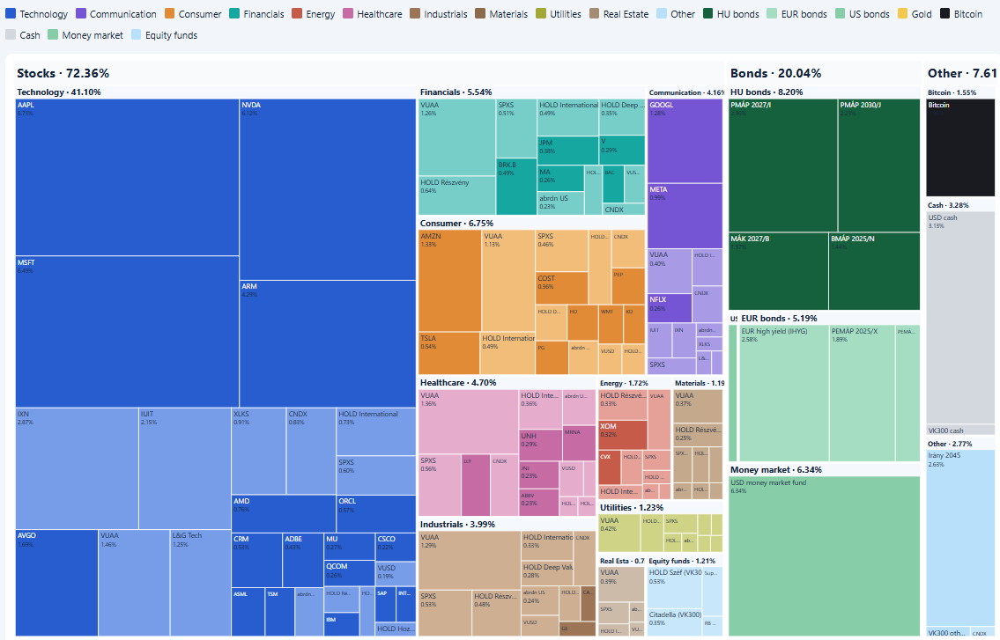
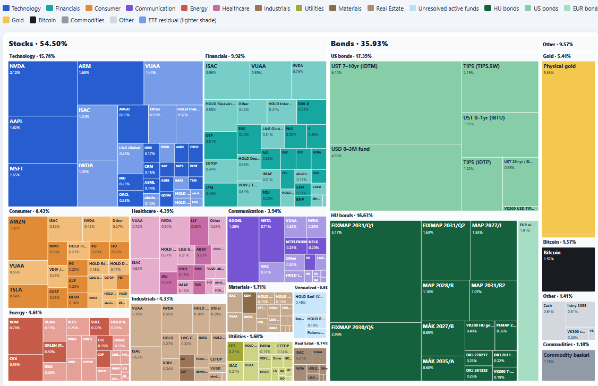

  <header class="post-hero">
    
Adam on FIRE · Blog

    <h1 class="post-title">{{ page.title | escape }}</h1>
    
{{ page.date | date: "%Y. %m. %d." }}

  </header>

  <article class="post-body">

Az elmúlt egy évben nagyon sokat tanultam arról, hogy mit is jelent a kockázatkezelés a portfólióm szintjén. Emlékszem, hogy már Trump 2024 novemberi megválasztásakor azt tűztem ki célül, hogy szeretném csökkenteni a kockázatomat. Egészen odáig azt éreztem, hogy csak felfelé mehet a piac, és hát a 2025 áprilisi vámháborús időszakig ez így is volt.
 

Szerencsére már a vámháború miatti esés előtt is megfogalmazódott bennem, hogy nem lehet mindent az USA piacra feltenni, ezért elkezdtem más pozíciókat is venni, és az újonnan befolyó pénzből kötvényeket - főleg magyar állampapírokat - vettem. Kicsit fordítva csináltam ezt az egész portfólióépítést az átlag magyar kisbefektetőhöz képest. Hiszen sokan először 100% kötvényben ülnek, majd szép lassan vesznek részvényalapokat a portfóliójukba. Én meg 2020 előtt nem is vettem állampapírt. Szóval mondhatni, hogy sokkal kockázatosabb portfólióval akartam FIRE lenni, mint ami feltétlenül szükséges lenne. 2024. szeptember 1-jén, amikor elkészült a portfóliókövetőm, így nézett ki a teljes portfólióm (köszönöm a chatgpt-nek, hogy ilyen jó grafikákat lehet már vele gyártani):

<strong>41% technológiai szektor! 4 tech részvény a portfólió közel 25%-a!</strong> Hát miféle diverzifikáció ez? És itt jön be, hogy akkor még azt hittem, hogy ez "elég diverzifikált". Aztán 2025 nyarán <a href="https://adamonfire.hu/blog-6">beszéltem Karstennel - az amerikai tanácsadóval -</a>, aki segített rájönni arra, hogy nem feltétlenül kell 70% részvényarány, elég lesz 55-60% is, hiszen a 4-4.5% reálhozamhoz nem feltétlenül kell több. Ennek hatására mentem is tovább, szépen adogattam el a Nasdaq ETF-jeimet - az utolsót október 7-én -, hiszen 40% feletti tech kitettség nem fog nekem kelleni, az inkább a növekedési szakaszban kell. És aztán jött 2026 ősze, amikor a <a href="https://bankarkepzo.hu/oktatas/programok/vagyon-alap-portfolio-vap-online">Bankárképző VAP képzésén (Vagyon- Alap- és Portfóliókezelés)</a> szó volt a kockázat és hozam kapcsolatáról. Most már tudom, hogy ez a leggyakoribb hibája a kisbefektetőknek, hogy csak a felfelé mutató kockázatot (nagy várható nyereséget) nézik, közben azt nem vizsgálják meg, hogy lefelé ugyanilyen kockázattal néznek szembe. És míg egy MSCI World 10% hozamot hoz 15%-os szórás mellett (tehát az esetek 95%-ában -18.5% és +46.5% között) hoz évente, addig egy Nasdaq-100 13%-ot 20%-os szórás mellett hoz (-24.5% és +65%). És persze, jól jön az az évi +3% hozam, de ha cserébe a lefelé mutató kockázat is nagyobb, akkor azon el kell gondolkozni.

Végül 26 hónap munkájával 2026 novemberére sikerült egy sokkal kiegyensúlyozottabb portfóliót kiépíteni, ami most így néz ki:

Ez egy klasszikus vegyes portfóliót idéz már, amelyben a szektorsúlyok majdnem megegyeznek az MSCI World súlyával, de van benne bőven kötvény is (különböző lejárattal), arany, bitcoin, nyersanyag, összesen közel 250 kisebb pozícióval. A várható hozama 8%, volatilitása 10% (szóval -11.5% és +31% között hoz majd évente). Ez egy sokkal-sokkal kiszámíthatóbb helyzetet ad, ráadásul van benne bőven mozgástér felfelé - a kötvények felélésével és/vagy részvénnyé alakításával. Ez is egy olyan szempont, ami akkor válik igazán fontossá, ha tudod, hogy már nem a legnagyobb hozam elérése a cél. Mert a FIRE nem a hozam- és vagyonmaximalizálásról, hanem a vagyon értékének megtartásáról szól. Ez lesz nekem is a célom a következő években, évtizedekben.

  </article>

  

    <a href="/blog">
      ←&nbsp;&nbsp; Vissza az összes bejegyzéshez
      Blog
    </a>
  

